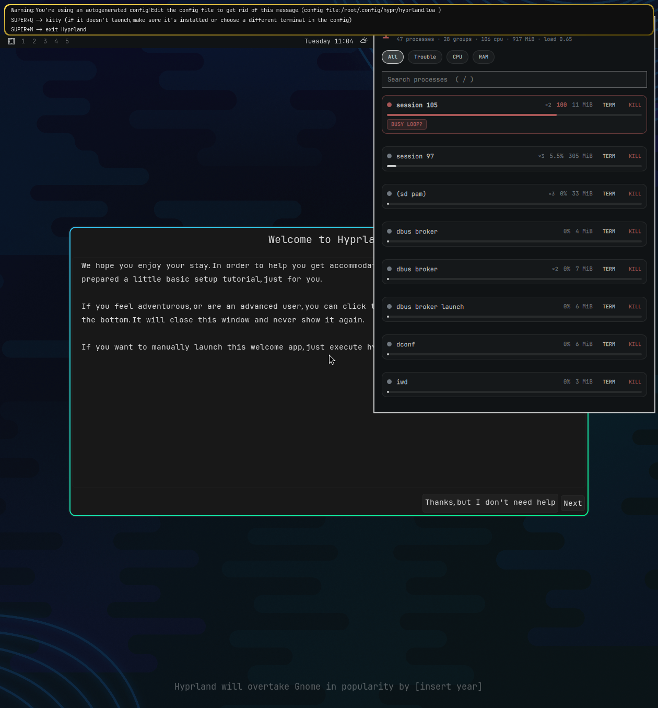

<div align="center">

# Process Pulse

**Process manager for the Omarchy bar: processes grouped by application, with live CPU/RAM, runaway detection, and one-press TERM/KILL.**

[](https://github.com/meviusisback/omarchy-kill-processes/releases)
[](LICENSE)




</div>

## Why it exists

`htop` shows a wall of rows. In real life a "process" is an application with
12 helpers, and the one you need to kill is stuck in a loop you can spot only
by watching CPU over time. Process Pulse does that watching for you: one row
per application, trouble flagged automatically, and a kill path that cannot hit
the wrong PID. The bar badge stays live even with the panel closed, so a
runaway announces itself instead of waiting to be found.

## What it does

- **Grouping** — processes are folded by their systemd/Hyprland cgroup (one
  row = one application). Launcher wrappers (`sh`, `gtk-launch`,
  `xdg-terminal-exec`, Electron helpers) are collapsed away, so you get
  `Firefox ×34`, not 34 rows.
- **Trouble detection** — a group is flagged when it contains:
  - `BUSY LOOP?` — a process pinned above ~95% of a core for `runawaySamples`
    consecutive samples (default ≈ 10 s);
  - `BLOCKED` — a task stuck in `D` state (uninterruptible wait);
  - `ZOMBIE` — dead children nobody reaped. Informational only: it never
    raises the red badge, because a zombie is already dead and clears on its
    own when its parent exits;
  - `SWARM` — an application spawning a suspicious number of helpers.
- **Kill that cannot go wrong**:
  - every PID is re-validated against the last snapshot (command + start time
    + owner) right before **every** signal, including the `SIGKILL` escalation
    step — a recycled PID is refused (`recycled-pid`);
  - other users' processes are refused (`not-yours`), so no `sudo`, ever;
  - `TERM` first, **2 s of grace**, then `SIGKILL` on survivors — a process
    that ignores TERM still dies (`killed: [pid]`);
  - zombies, PID 0/1/2 and PIDs never seen in a snapshot are refused.
- **Panel** — header with trouble count + totals (processes, groups, CPU, RAM,
  load); filter chips (**All / Trouble / CPU / RAM**); search box (`/` from the
  keyboard) with live filtering over names, PIDs and command lines; per-group
  severity dot, `×N` helpers, CPU bar, `TERM` / `KILL`; expand a group
  (click / `Enter`) to see single processes with PID, state, age, CPU, RAM and
  command preview, with per-process `T` / `K` too; confirm dialog before every
  signal issued from the panel, and a toast with the outcome (the IPC control
  surface skips the dialog by design — see [How it works](#how-it-works)).

### Keys (panel focused, search empty)

| Key | Does |
| --- | --- |
| `j` / `k`, arrows | move cursor |
| `Enter` | expand / collapse group |
| `d`, `Del` | stop group (confirm) |
| `/` | focus search |
| `r` | refresh now |
| `Esc` | clear search, then close |

## Install

```bash
omarchy plugin add https://github.com/meviusisback/omarchy-kill-processes.git --enable
omarchy bar put meviusisback.kill-procs --after meviusisback.hw-monitor
```

## Usage

Open the panel from the bar widget. Filter with the chips or `/` search,
expand a group to inspect single processes, and stop a whole group or one
process with `TERM` / `KILL` (confirmed, then toasted).

The widget also exposes a Quickshell IPC target with `open`, `close`,
`toggle`, `refresh`, `search` and `kill`. It can only reach what the panel
could reach — the kill path re-validates every PID against the snapshot and
your own UID before signalling — it just skips the confirmation dialog.

## Requirements

- Linux with `/proc` (grouping reads cgroups; CPU deltas need two samples, so
  figures become accurate one interval after opening)
- `python3` — both helpers are stdlib-only, spawned as argv arrays with
  absolute paths, no shell strings, no network
- No `sudo`, no daemon, no pip packages

## Configuration

Bar widget settings:

| Key | Type | Default | Description |
| --- | --- | --- | --- |
| `refreshIntervalSec` | integer | `2` | How often the panel re-reads the processes while it is open (1–30). CPU figures need two samples, so they become accurate after one interval. Busy-loop detection fires after about `runawaySamples` intervals. |
| `runawaySamples` | integer | `5` | Consecutive samples a process must stay above ~95% of a core before it is flagged as a probable busy loop (2–30). At the default refresh (2 s) that is about 10 seconds. |
| `sort` | string | `severity` | Order of the group list: `severity` (problems first), `cpu`, `mem` or `name`. |
| `showTotals` | boolean | `true` | Show process count, total CPU and RAM in the panel header. |

## How it works

| File | Role |
| --- | --- |
| `Panel.qml` | bar widget + panel (Quickshell) |
| `probe.py` | reads `/proc` once per tick and diffs against the previous tick → groups, CPU deltas, trouble flags (JSON) |
| `kill.py` | validates PIDs against the snapshot, sends TERM→KILL |
| `tests/test_probe.py` | fixture unit tests, no `/proc`, no network |

Both helpers cap their output (60 groups, 12 processes per group, bounded
strings). With the panel open the snapshot refreshes every
`refreshIntervalSec`; closed, the bar re-checks every 10 s so the red badge
stays live. A snapshot only reads `/proc` and writes one small state file — no
shell, no network.

Threat model, in short: Process Pulse runs unsandboxed inside `omarchy-shell`
as your user, like every Omarchy plugin. **Same-user trust** — anything running
as you could already send signals itself; IPC can only reach what the panel
could reach. **Names are claims, PIDs are facts** — a row's label can lie (any
process can rename itself), but the PID signalled is checked against kernel
start time and owner, so a decoy can only get itself killed, never somebody
else's process. **State file** — `~/.local/state/omarchy-killprocs/` is created
`0700` and written atomically; both helpers refuse stale (> 2 min), malformed
or future-dated snapshots before acting on them. **No network, no shell, no
secrets.**

Run the tests (hermetic — stdlib, no compositor, no network):

```bash
python3 tests/test_probe.py
```

## Removal

```sh
omarchy plugin remove meviusisback.kill-procs
```

That drops it from the bar and deletes the plugin. Per-widget settings live in
the shell's own config (`~/.config/omarchy/shell.json`) and are left for the
shell to prune. The state directory `~/.local/state/omarchy-killprocs/` is
yours to delete if you want no trace left.

## License

MIT — see [LICENSE](LICENSE).
