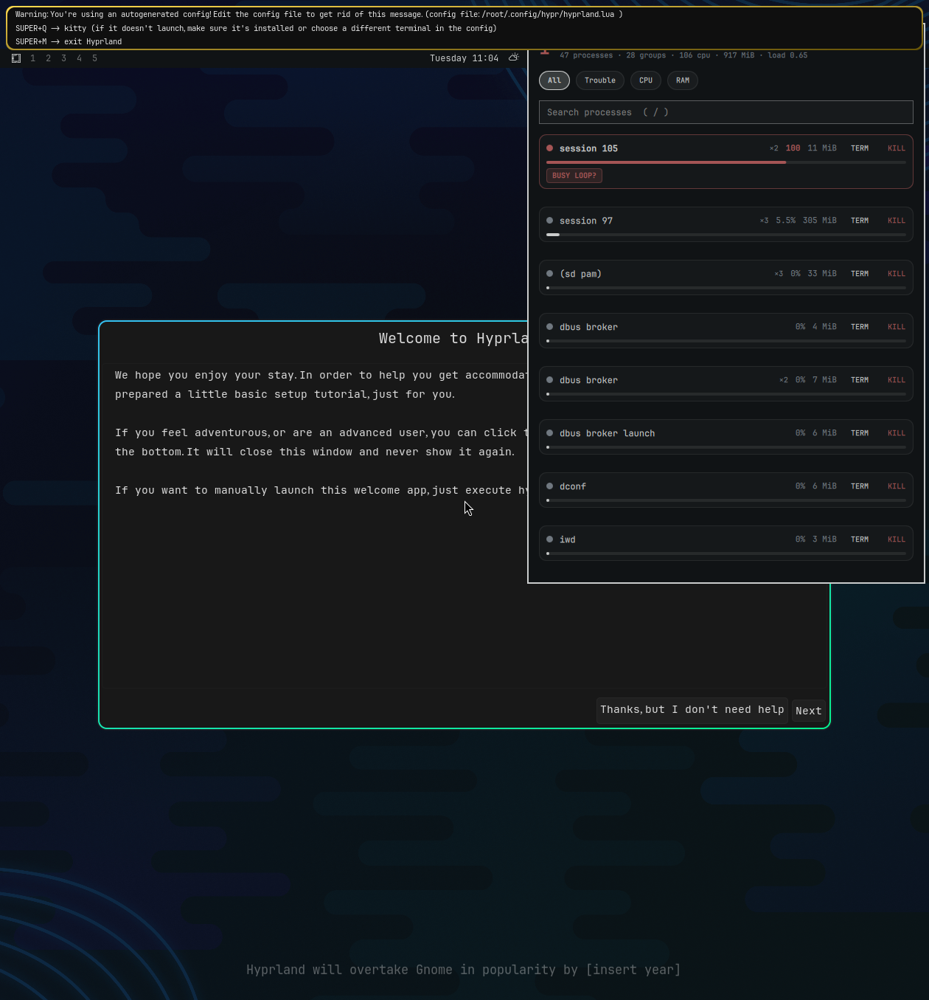

# Process Pulse (meviusisback.kill-procs)

Elegant process manager for the Omarchy bar: processes **grouped by
application**, live CPU/RAM, automatic detection of processes in trouble,
and a one-press **TERM / KILL** for a whole group or a single process.



## Why

`htop` shows a wall of rows. In real life a "process" is an application
with 12 helpers, and the one you need to kill is stuck in a loop you can
spot only by watching CPU over time. Process Pulse does that watching for
you:

- **Grouping** — processes are folded by their systemd/Hyprland cgroup
  (one row = one application). Launcher wrappers (`sh`, `gtk-launch`,
  `xdg-terminal-exec`, Electron helpers) are collapsed away, so you get
  `Firefox ×34`, not 34 rows.
- **Trouble detection** — a group turns red when it contains:
  - `BUSY LOOP?` — a process pinned above ~95% of a core for
    `runawaySamples` consecutive samples (default ≈ 10 s);
  - `BLOCKED` — a task stuck in `D` state (uninterruptible wait);
  - `ZOMBIE` — dead children nobody reaped. Informational only: it never
    raises the red badge, because a zombie is already dead and clears on
    its own when its parent exits;
  - `SWARM` — an application spawning a suspicious number of helpers.
- **Kill that cannot go wrong**:
  - every PID is re-validated against the last snapshot
    (command + start time + owner) right before signalling — a recycled
    PID is refused (`recycled-pid`);
  - other users' processes are refused (`not-yours`), so no `sudo`,
    ever;
  - `TERM` first, **2 s of grace**, then `SIGKILL` on survivors — a
    process that ignores TERM still dies (`killed: [pid]`);
  - zombies, PID 0/1/2 and PIDs never seen in a snapshot are refused.

## Panel

- header: trouble count + totals (processes, groups, CPU, RAM, load)
- filter chips: **All / Trouble / CPU / RAM**
- search box (`/` from the keyboard), live filtering over names, PIDs
  and command lines
- per-group: severity dot, `×N` helpers, CPU bar, `TERM` / `KILL`
- expand a group (click / `Enter`) to see single processes with PID,
  state, age, CPU, RAM and command preview; per-process `T` / `K` too
- confirm dialog before every signal; toast with the outcome

### Keys (panel focused, search empty)

| key | action |
| --- | --- |
| `j` / `k`, arrows | move cursor |
| `Enter` | expand / collapse group |
| `d`, `Del` | stop group (confirm) |
| `/` | focus search |
| `r` | refresh now |
| `Esc` | clear search, then close |

## Install

```bash
omarchy plugin add https://github.com/meviusisback/omarchy-kill-processes.git --enable
omarchy bar add meviusisback.kill-procs --section right
```

Settings (bar widget settings): `refreshIntervalSec` (1–30, default 2),
`runawaySamples` (2–30, default 5), `sort` (`severity|cpu|mem|name`),
`showTotals`.

## Architecture

| file | role |
| --- | --- |
| `Panel.qml` | bar widget + panel (Quickshell) |
| `probe.py` | reads `/proc` twice → groups, CPU deltas, trouble flags (JSON) |
| `kill.py` | validates PIDs against the snapshot, sends TERM→KILL |
| `tests/test_probe.py` | fixture unit tests, no `/proc`, no network |

Both helpers are Python stdlib only, spawn with absolute paths, never
build shell strings, and cap their output (60 groups, 12 processes per
group, bounded strings). With the panel open the snapshot refreshes
every `refreshIntervalSec`; closed, the bar re-checks every 10 s so the
red badge stays live. One snapshot costs about 40 ms.

## Tests

```bash
python3 tests/test_probe.py
```

## License

MIT
